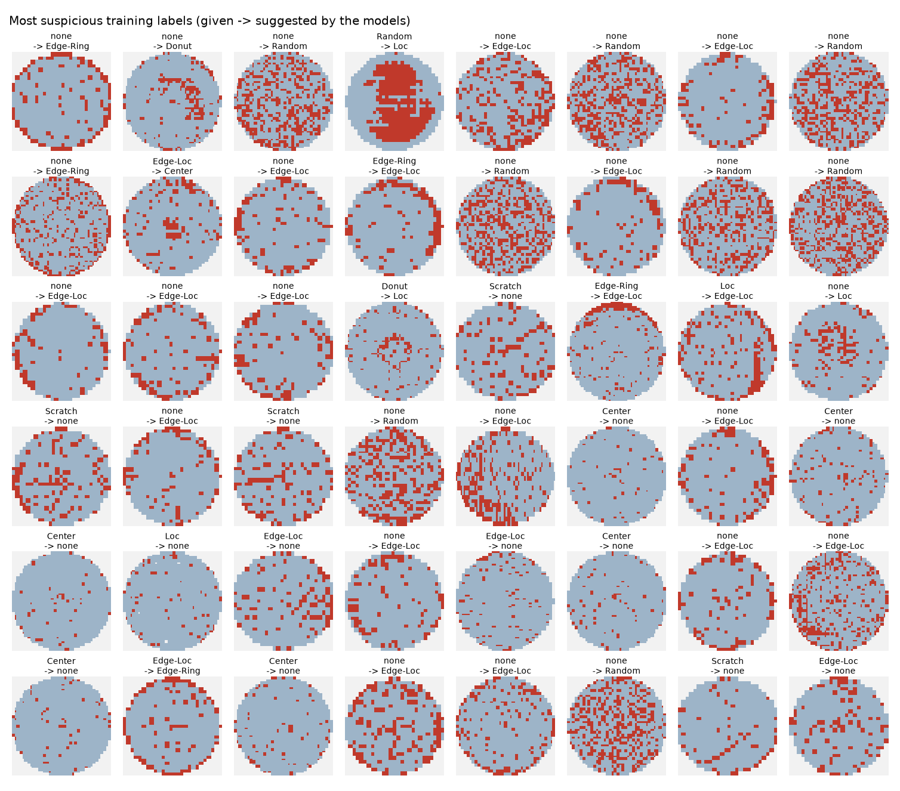
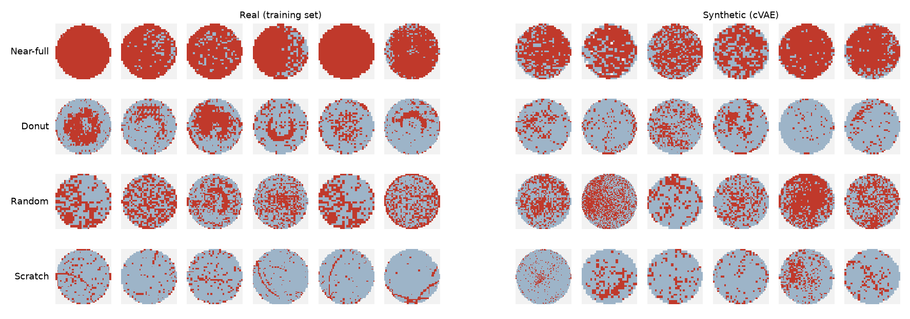

# waferwise

Wafer-map defect classification on WM-811K, from noisy, imbalanced data to a model that runs in real time on an Intel CPU.

> The data was dirty and imbalanced. I fixed the labels, created the rare defects that were missing, then shipped a model that runs in real time on an Intel CPU and flags what it's unsure about.

**Status:** work in progress. Results, benchmarks and a demo will be added here.

## Pipeline

1. Baseline defect-pattern classifier (PyTorch)
2. Label audit with confident learning (cleanlab) to find likely mislabelled wafers
3. Synthetic rare defects from a small conditional generative model
4. Deployment: ONNX -> OpenVINO, INT8 with NNCF, C++ inference CLI, confidence gate
5. Benchmarks: FP32 vs INT8, Python vs C++

## Setup

Python 3.10+ (developed on 3.12). Everything runs on a laptop CPU; a GPU is used if present.

```bash
python -m venv .venv
source .venv/bin/activate        # Windows: .venv\Scripts\activate
python -m pip install --upgrade pip
pip install -r requirements.txt
pip install -e .
```

## Getting the data

The dataset is [WM-811K (LSWMD.pkl)](https://www.kaggle.com/datasets/qingyi/wm811k-wafer-map) on Kaggle, about 2 GB.

1. Create a Kaggle API token: kaggle.com -> Settings -> API -> **Create New Token**. Save the downloaded
   `kaggle.json` to `~/.kaggle/kaggle.json` (Windows: `C:\Users\<you>\.kaggle\kaggle.json`). Keep it out of the repo.
2. Download and prepare the data:

```bash
python scripts/download_data.py   # -> data/raw/LSWMD.pkl
python scripts/prepare_data.py    # -> data/processed/wm811k_64.npz (+ checks splits/splits_seed42.npz)
python scripts/eda.py             # -> outputs/eda/ (figures + summary.json)
pytest
```

`LSWMD.pkl` was saved with a very old pandas version that modern pandas cannot always read. `waferwise.data.read_lswmd`
tries `pandas.read_pickle` first and otherwise falls back to a small compatibility reader: it unpickles with pandas
classes replaced by inert stubs and rebuilds the DataFrame from the raw NumPy column blocks, so it works with any pandas
version. That reader only allows NumPy and a few safe built-ins to be loaded from the file.

### Data processing choices

- Only the 172,950 labelled wafers are used (9 classes: Center, Donut, Edge-Loc, Edge-Ring, Loc, Near-full, Random, Scratch, none).
- Maps are resized to 64x64 with nearest-neighbour sampling, so pixels stay valid codes (0 off-wafer, 1 pass, 2 fail).
- One stratified 70/15/15 train/val/test split (seed 42) is committed in `splits/` as LSWMD row numbers. The test set is
  never cleaned, augmented or used for tuning.
- WM-811K contains 3,250 groups of pixel-identical wafer maps. A plain random split put 704 test wafers' exact copies
  in the training set, so the split keeps every duplicate group inside a single split.

## Training and evaluation

```bash
python scripts/train.py --config configs/baseline.yaml           # -> outputs/baseline/
python scripts/evaluate.py --run outputs/baseline --split test   # final numbers only, never for tuning
```

Each run writes `model.pt`, `history.json`, `training_curves.png`, `metrics_val.json` and a row-normalised
confusion matrix (`confusion_val.png`) to `outputs/<experiment_name>/`. Every run uses the full 30 epochs and keeps the
checkpoint with the best validation macro-F1. Early stopping is effectively off: validation macro-F1 swings widely until
the cosine learning rate decays (rare classes have only 21-178 validation wafers), so a short patience stopped some runs
at random around epoch 16 and made equal setups look different.
Every report includes macro-F1 and per-class recall, because plain accuracy is misleading here: predicting "none" for
every wafer already scores 85%.

**Baseline:** a 4-block CNN (~99k parameters) on 1x64x64 maps, AdamW, cosine learning rate, random flips and
90-degree rotations, and cross-entropy weighted by 1/sqrt(class frequency).

## Results so far

| Model | Train data | Val macro-F1 | Test macro-F1 | Test macro recall | Test accuracy |
|---|---|---|---|---|---|
| Baseline CNN (FP32, PyTorch) | real, uncleaned | 0.873 | 0.871 | 0.893 | 0.972 |
| **Final model** (same CNN, see [below](#which-training-data-works-best)) | real + oversampled rare classes | 0.874 | 0.872 | 0.897 | 0.974 |
| Final model, INT8 (OpenVINO), see [Deployment](#deployment) | real + oversampled rare classes | 0.867 | 0.872 | 0.897 | 0.974 |

Per-class test recall for the baseline:

| Center | Donut | Edge-Loc | Edge-Ring | Loc | Near-full | Random | Scratch | none |
|---|---|---|---|---|---|---|---|---|
| 0.93 | 0.89 | 0.85 | 0.97 | 0.74 | 0.95 | 0.95 | 0.77 | 0.99 |

The weakest classes are Loc and Scratch. 13% of each is predicted as "none", and in the other direction "none" wafers
are most often confused with Edge-Loc, Loc, Center and Scratch. Small local defects and clean wafers are the hardest
boundary, and that is where the label audit looks next.

## Label audit

The labels themselves are noisy: the dataset contains pixel-identical wafers with different labels. To find likely
label errors in the **training set** (val and test labels are never changed):

1. **Out-of-sample predictions.** The training split is cut into 5 folds (duplicates kept together). For each fold a
   model is trained on the other 4 and predicts the held-out one, so every training wafer gets a prediction from a
   model that never saw it. This is done for three different models: the baseline CNN, a smaller CNN with another
   seed, and gradient-boosted trees on hand-made features (failure density grid, radial ring profile).
2. **Confident learning** ([cleanlab](https://github.com/cleanlab/cleanlab)) on the averaged predictions estimates how
   often each class is confused with each other class and flags wafers whose given label is unlikely.
3. **Ensemble disagreement.** A wafer is dropped only if cleanlab flags it **and** all three models agree on the same
   other class.

```bash
python scripts/cross_val.py --config configs/audit_cnn_a.yaml   # out-of-fold CNN predictions (folds can run in parallel)
python scripts/cross_val.py --config configs/audit_cnn_b.yaml
python scripts/label_audit.py                                   # -> audit/suspect_labels.csv + review grids
python scripts/train.py --config configs/cleaned.yaml           # retrain without the dropped wafers
```

**What it found:** 862 wafers flagged by cleanlab and 563 (0.47% of training) flagged by both signals. The suspects
concentrate in the confusable classes: 5.4% of Scratch labels, 4.8% of Loc and 2.3% of Edge-Loc, against 0.23% of
"none". The most common corrections are none -> Edge-Loc (129), none -> Loc (77), Loc -> Edge-Loc (50) and
Edge-Ring -> Edge-Loc (48). The full list with scores is in [`audit/suspect_labels.csv`](audit/suspect_labels.csv).



Reviewing the grids by hand: many suspects are clear errors, such as "Center" wafers with no centre cluster, or
"none" wafers covered in random failures. Others are honest borderline cases (a partial ring between Edge-Ring and
Edge-Loc). A few are model mistakes, mostly thin scratches the 64x64 CNN does not see. So the audit is a useful filter
for a human reviewer, not a replacement for one.

**Effect of removing the 563 suspects** (mean +/- std over 2 seeds each):

| Train data | Val macro-F1 | Test macro-F1 | Test macro recall | Test macro precision | Test recall Scratch / Center / Random |
|---|---|---|---|---|---|
| Real, uncleaned | 0.874 +/- 0.001 | 0.871 +/- 0.000 | 0.892 | 0.853 | 0.78 / 0.93 / 0.95 |
| Real, cleaned | 0.869 +/- 0.002 | 0.869 +/- 0.002 | 0.894 | 0.848 | 0.76 / 0.93 / 0.95 |

Removing 0.5% of the labels did **not** measurably change the model: macro-F1, macro recall and macro precision all
stay within seed-to-seed noise. One honest caveat: val and test contain the same kind of label errors (they are
deliberately left untouched), so a model that has stopped learning "defect-looking wafer = none" is partly penalised
by those noisy labels, and any real gain may be hidden. The audit's lasting value is the list of suspect wafers for a
human reviewer, rather than a better score.

## Synthetic rare defects

The four rarest classes have only 107 (Near-full), 384 (Donut), 598 (Random) and 791 (Scratch) cleaned training
wafers. A small **conditional VAE** (1.8M parameters, 12 minutes on a laptop CPU) learns where failing dies appear for
each class and generates new ones:

- It models only the *fail map* (which dies failed), conditioned on the class. Training uses balanced epochs (every
  class seen equally often) and random rotations/flips, on the cleaned training split only.
- Each synthetic wafer borrows its outline and die grid from a random real wafer of the same class. Dies pass or fail
  **one die at a time**, using the model's average failure probability over that die. Sampling every pixel
  independently gave fine salt-and-pepper noise that looked nothing like real maps (most wafers have only ~25x27 dies
  scaled up to 64x64); sampling per die reproduces their blocky look.

```bash
python scripts/train_vae.py            # -> outputs/cvae/model.pt
python scripts/generate_synthetic.py   # -> data/synthetic/cvae.npz (2,000 per rare class)
python scripts/realism_check.py        # -> outputs/realism/summary.json
```



**Realism check** (all on training data; val and test are not used):

| Class | Real-vs-synthetic detector AUC (CNN / trees) | Baseline classifier picks the intended class | Copies of training wafers |
|---|---|---|---|
| Near-full | 0.83 / 0.92 | 79% | none |
| Random | 0.84 / 0.87 | 85% | none |
| Donut | 0.89 / 0.95 | 53% (else mostly Loc) | none |
| Scratch | 0.89 / 0.85 | **2%** (almost all "none") | none |

The detector AUCs (0.5 would mean indistinguishable) show the synthetic wafers are still recognisably synthetic,
which is typical for a VAE: it averages over possibilities and produces softer patterns than real wafers. Copying is
ruled out: no synthetic wafer is closer to a training wafer than the closest 5% of real-to-real pairs. Blob- and
texture-like defects (Near-full, Random, partly Donut) come out recognisable. Thin scratches do not: the VAE blurs a
one-die-wide line into background noise. Sharpening the probabilities or lowering the sampling temperature helped
Near-full and Donut a little but hurt Random, and did not rescue Scratch, so the plain settings are kept.

## Which training data works best

All five setups use the same CNN and settings, two seeds each, and the full 30 epochs. Oversampling and synthetic data
add the same thing: 2,000 extra wafers each for Near-full, Donut and Random, in the training set only. Scratch gets no
extras, because synthetic scratches failed the realism check. Loss weights are computed on the final training mix, so
the extra wafers do not over-weight those classes.

```bash
python scripts/train.py --config configs/oversampled.yaml --seed 1   # also: synthetic.yaml, cleaned_synthetic.yaml
python scripts/compare_runs.py --split val --out outputs/compare     --arm real outputs/baseline outputs/baseline_seed1     --arm oversampled outputs/oversampled_seed42 outputs/oversampled_seed1
```

Mean +/- std over 2 seeds:

| Train data | Val macro-F1 | Test macro-F1 | Test macro recall | Test macro precision | Test recall Donut / Near-full / Random |
|---|---|---|---|---|---|
| Real only | 0.874 +/- 0.001 | 0.871 +/- 0.000 | 0.892 | 0.853 | 0.91 / 0.90 / 0.95 |
| Cleaned | 0.869 +/- 0.002 | 0.869 +/- 0.002 | 0.894 | 0.848 | 0.92 / 0.93 / 0.95 |
| Real + oversampling | 0.873 +/- 0.001 | 0.865 +/- 0.011 | 0.896 | 0.840 | 0.94 / 0.95 / 0.97 |
| Real + synthetic | 0.842 +/- 0.009 | 0.824 +/- 0.010 | 0.848 | 0.807 | 0.83 / 0.81 / 0.88 |
| Cleaned + synthetic | 0.845 +/- 0.003 | 0.825 +/- 0.001 | 0.848 | 0.810 | 0.84 / 0.86 / 0.88 |

**Synthetic wafers made the model worse**, by about 0.03-0.05 macro-F1 on both val and test, and they lowered recall on
the very classes they were meant to help. The realism check predicted why. A sample labelled Donut that looks like Loc
teaches the model that Loc-like wafers can be Donut, so the class boundaries blur: on validation, Donut precision fell
from 0.85 to 0.71, Near-full from 0.89 to 0.74 and Random from 0.88 to 0.82, with more confusion between Donut and Loc
and between Random and Near-full. Adding more data only helps if it is good enough, and a VAE that a detector can spot
(AUC ~0.87) was not. A sharper generator might change this, but a new generator would have to beat oversampling to be
worth its cost.

**Oversampling ties with real-only on macro-F1** and leans towards rare-class recall, at the cost of some precision.
With so few rare wafers (21 Near-full and 83 Donut in test) these recall differences are within noise.

**Final model:** real + oversampling, seed 1, chosen on validation before any oversampled or synthetic model was run on test
(highest val macro-F1 within seed noise, tie broken by rare-class recall). On test it scores macro-F1 0.872, macro
recall 0.897 and accuracy 0.974. The other seed scored 0.857, so 0.87 +/- 0.01 is the fairer expectation than the single
number. It is a tie-break between equals: the plain baseline would be a defensible choice too.

Per-class test results for the final model:

| | Center | Donut | Edge-Loc | Edge-Ring | Loc | Near-full | Random | Scratch | none |
|---|---|---|---|---|---|---|---|---|---|
| Recall | 0.90 | 0.94 | 0.83 | 0.97 | 0.74 | 1.00 | 0.97 | 0.73 | 0.99 |
| Precision | 0.94 | 0.70 | 0.82 | 0.97 | 0.76 | 0.95 | 0.83 | 0.71 | 0.99 |

## Deployment

```bash
python scripts/export_model.py                  # ONNX, OpenVINO FP32, INT8 -> outputs/deploy/
python scripts/calibrate_gate.py                # picks the review threshold on val -> gate.json
python scripts/evaluate_deployed.py --split test
```

The final model goes from PyTorch to ONNX to OpenVINO, then to INT8 with NNCF. Quantisation is calibrated on 900 training
wafers, 100 per class, so the rare classes are represented. The threshold and all quantisation settings were fixed on
val before the test set was used.

| Test set | FP32 | INT8 |
|---|---|---|
| Macro-F1 | 0.8723 | 0.8717 |
| Macro recall | 0.8970 | 0.8972 |
| Accuracy | 0.9735 | 0.9737 |
| Weights file | 0.39 MB | 0.10 MB |

Every class's test recall stays within 0.006 of FP32. The largest precision change is Random, from 0.83 to 0.81. The
first INT8 attempt lost 0.015
macro-F1 on val, with Random precision falling to 0.71. Turning on full bias correction cut that loss to 0.007 on val.
Exported FP32 matches PyTorch to within 0.000003 in probability with no label changes.

### Confidence gate

A wafer is decided automatically only if the model's top probability reaches a threshold. Anything below it goes to a
person. The threshold is 0.871, the lowest value that reaches 99.5% accuracy on automatic decisions on val, measured on
the INT8 model itself.

| Test set (25,966 wafers) | No gate | With gate |
|---|---|---|
| Sent to review | 0% | 7.4% |
| Wrong automatic decisions | 683 | 130 |
| Defects called "none" | 225 | 60 |
| Accuracy on automatic decisions | 97.4% | 99.46% |

The target was 99.5% and test reached 99.46%, as expected from val: on held-out halves of val the worst case was 99.37%.

Review is not spread evenly. It takes 56% of Loc wafers, 44% of Scratch and 41% of Edge-Loc, but only 4% of "none". The
gate buys its accuracy by removing the hard classes from automation, and 60 defects still pass as clean.

The threshold is a business choice. On val, a 99.0% target reviews 4.2% of wafers and a 99.8% target reviews 15.8%.
Only the ranking of confidences matters here, so the model did not need temperature scaling.

**Why not conformal prediction?** I tried per-class conformal thresholds first. They kept their promised coverage, but
coverage is a different goal from accurate automatic decisions. At a similar 8.6% review rate on val they left about 7
times as many errors as the plain threshold, and more errors than having no gate at all. The method was also unstable:
going from alpha 0.1 to 0.05 moved review from 8.6% to 99.6%, because the Loc and Scratch thresholds fall to 0.02-0.04 and
those classes then enter almost every prediction set. The simple threshold is both better and easier to explain.

### C++ inference

`cpp/` contains `waferwise_infer`, a command-line tool that loads the INT8 model and `gate.json`, classifies PNG wafer
maps, and writes each decision to a CSV file. Build steps are in [cpp/README.md](cpp/README.md).

Its answers were compared with Python's using `scripts/check_cpp.py`:

| Check on val | Wafers | Different labels | Different gate decisions |
|---|---|---|---|
| 64x64 PNGs, batch sizes 1, 32 and 1024 | 25,955 | 0 | 0 |
| Original-size wafers (166 different sizes), resized by the C++ tool | 3,000 | 0 | 0 |

Confidences agree to 0.0000005, which is the rounding in the CSV. The original-size check matters because plain OpenCV
`INTER_NEAREST` picks different pixels from the resize used in training. The tool uses `INTER_NEAREST_EXACT`, and
a test guards that match.

## Repository layout

```
configs/      YAML configs (no hard-coded settings)
src/waferwise/
  data.py     loading, preprocessing, splits, Dataset
  models.py   model definitions
  train.py    training loop
  evaluate.py macro-F1, per-class recall, confusion matrix
  label_audit.py  cross-validation folds, cleanlab + ensemble disagreement
  generative.py   conditional VAE and die-level sampling of synthetic wafers
  deploy.py   ONNX and OpenVINO export, INT8 quantisation
  gate.py     confidence threshold and its report
  utils.py    seeding, logging, paths
scripts/      command-line entry points
splits/       the fixed train/val/test split
audit/        suspect-label list from the label audit (defines the cleaned training set)
cpp/          C++ inference (OpenVINO + OpenCV)
tests/        sanity tests
notebooks/    exploration only
```
